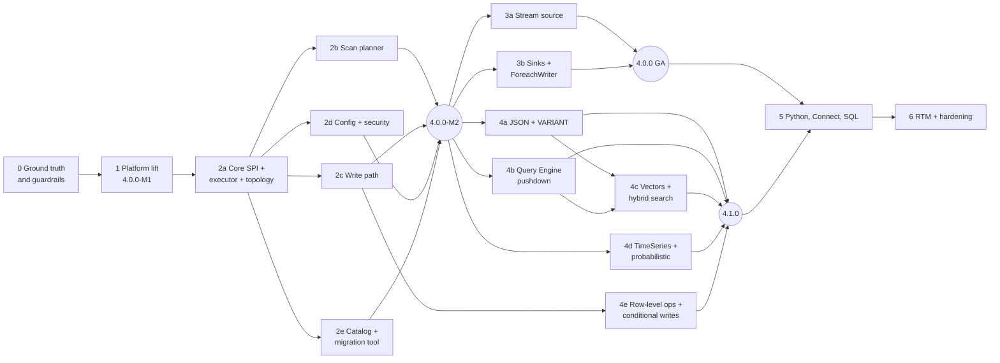

# Roadmap: spark-redis 3.x → 4.x

> Stage: **Build planning** (AI-native SDLC playbook). Inputs: [`intent.md`](intent.md) (why) and
> [`spec.md`](spec.md) (what). This file sets the order of the work. When a phase starts, its owner opens
> Claude Code in plan mode with this file and the spec, and commits a `plan.md` for the phase under
> `doc/modernization/plans/`. That plan names the files, the order of changes, the tests, the risks and the
> proof for each step. The playbook's test for a good plan applies: an engineer who never saw the
> conversation should be able to implement the change from the plan alone.

## Where we are

| | Today (`master`, Sep 2026) | Target |
|---|---|---|
| Spark | 3.2.1 (EOL) | 4.1, 4.2, 4.3; then 4.4 and the 4.5 LTS as they ship |
| Scala / JDK | 2.12 / Java 8 | 2.13 / JDK 17 (tested on 17, 21 and 25) |
| Redis | tested against 6.0.10 | 8.2 (floor) through 8.10; 8.12 when it reaches GA |
| Client | Jedis 3.9 | Jedis 8.0 |
| Wire protocol | RESP2 | RESP3 only, with no fallback |
| Spark API | DSv1 plus the internal V1 streaming `Source`, and DStreams | DSv2 throughout: catalog, pushdown, row-level ops, streaming source and sink |
| Redis data models | strings, hashes, lists, sets, sorted sets, streams | adds JSON/`VARIANT`, Query Engine, Vector Sets, vector fields, TimeSeries and probabilistic types |
| Clients reached | Scala and Java; PySpark for DataFrames only | adds Spark SQL catalog, Spark Connect (Python/Scala), and a pip package |
| Release | OSSRH, which is shut down | Central Portal and PyPI |
| Backlog | ~100 open issues, many duplicates | each one closed by a phase below, or explicitly declined |

**Prior art to reuse:**

- [RedisLabs/spark-redis#394](https://github.com/RedisLabs/spark-redis/pull/394) ("[WIP] Prepare for
  Spark 4"). It moves to Scala 2.13, JDK 17, Jedis 5 and `CLUSTER SHARDS`, and removes DStreams. It has been
  open with no reviews since October 2024, and Phase 1 starts from it.
- Redis field engineering's *Redis Connector for Spark*
  ([docs](https://redis-field-engineering.github.io/redis-spark/),
  [binaries](https://github.com/redis-field-engineering/redis-spark-dist)). See the
  [comparison below](#comparison-with-the-redis-connector-for-spark).
- [llphxd/spark-redis-connector](https://github.com/llphxd/spark-redis-connector), a community project
  (Apache-2.0; v0.1.4, Nov 2026; one maintainer).
  - **What it is:** a DataSource V2 batch connector for Spark 3.3–3.5, Scala 2.12 and Jedis 5. It reads
    and writes strings, hashes, lists, sets and sorted sets, each with a consistent table layout.
  - **What it lacks:**
    - it cannot load on Spark 4, which is Scala 2.13 only
    - no Redis Cluster routing: one pool to a single `host:port`
    - no pushdown beyond column pruning
    - no streaming
    - none of the Redis 8 types
    - overwrite deletes and then writes, which is not atomic
  - **Why it matters:** compare its per-type default schemas and option names (`type`, `key.prefix`,
    `keys`, `field.column`, `list.read.mode = explode | array`) against spec §2.2 before Phase 2b/2c. Its
    author is also a candidate contributor (intent open question 4), for example for the
    `zset`/`list`/`set` models. Any code we copy keeps its Apache-2.0 license and notices.

### Comparison with the Redis Connector for Spark

This compares the roadmap with the Redis Connector for Spark at **v0.10.0** (Sep 2026). It draws only on
that connector's public docs and its public distribution repo.

| Area | Redis Connector for Spark (v0.10.0) | This roadmap |
|---|---|---|
| License and source | Business Source License 1.1; source not published. Redis supports it for enterprise-tier customers as a "Developer Tool" | BSD-3-Clause, open source |
| Spark / Scala / Java | Spark 3.5.4 recommended (3.1–3.5 should work), Scala 2.12 only, Java 8+. No Spark 4 build | Spark 4.1–4.3, Scala 2.13, JDK 17+ (§1) |
| Redis | 5 and later | 8.2 and later, with capability gating for newer commands (§1) |
| Reads | `SCAN`-based key reads (pattern, type, threads, batch size, replica reads); stream reads through consumer groups | Point lookups, runtime filtering, Query Engine pushdown and slot-partitioned key scans; stream reads in range or group mode (§2.3, §2.5) |
| Write types | Hash, JSON (the default), string, stream | Those, plus sorted set, list, set, TimeSeries, Vector Set, vector fields and probabilistic types (§2.2) |
| Write semantics | Append and overwrite | Also merge or replace, TTL options, conditional writes, and `MERGE`/`UPDATE`/`DELETE` (§2.4) |
| Streaming | Micro-batch and continuous processing. The stream source is at-least-once, with batched acks. Live key changes come through keyspace notifications | DSv2 micro-batch with stream IDs held in the checkpoint, exactly-once with `IDMP`, admission control and `AvailableNow`. Real-Time Mode replaces continuous processing. Keyspace notifications are not used, because they are not durable (§2.5) |
| Redis 8 features | None documented | Central to the design: JSON/`VARIANT`, Query Engine, `FT.HYBRID`, Vector Sets, `HSETEX`, `SET IFEQ`, `XADD IDMP`, … (§1, §2.2–§2.5) |
| SQL catalog and functions | None documented | `TableCatalog`, `CREATE TABLE` → `FT.CREATE`, `redis_slot()` and other functions (§2.6) |
| Python and Spark Connect | DataFrame options from PySpark | pip package, pure-Python fallback, Connect test suite (§2.7) |
| Migration from spark-redis 3.x | Not a goal | Option aliases, golden-layout tests, migration tool (§2.11) |

**Where they overlap.** The Redis Connector for Spark already covers part of Phase 2: the DSv2 batch
scaffolding, a cluster-aware client, replica reads and the hash, JSON and string write paths. It also covers
part of Phase 3: a consumer-group stream source and a streaming sink. It covers nothing from Phase 1
(Spark 4), Phase 4 (Redis 8 data models), Phase 5 (Python and Connect) or Phase 6.

## Release train

| Phase | Release | What users get | Main gate |
|---|---|---|---|
| 0. Ground truth and guardrails | none | A test suite and CI running on Redis 8; agent guardrails in place | Product owner approves the intent and spec |
| 1. Platform lift | **4.0.0-M1**, plus 3.2.0 on `branch-3.x` | Today's features running on Spark 4.1–4.3, Redis 8.2+ and Jedis 8 | All golden-layout tests pass across the matrix |
| 2. DataSource V2 batch core | **4.0.0-M2** | Pushdown, slot-aware writes, Sentinel, replica reads, catalog, metrics, migration tool | At least 2× write throughput; point lookups run without `SCAN` |
| 3. Streaming on DSv2 | **4.0.0 GA** | A reliable stream source, sinks for every model, exactly-once with `IDMP` | Kill-and-replay tests show no loss or duplicates |
| 4. Redis 8 data models | **4.1.0** | JSON/`VARIANT`, Query Engine pushdown, vectors, hybrid search, TimeSeries, `MERGE`/`UPDATE`/`DELETE` | Proof that pushdown reads only what the query needs |
| 5. Python, Connect and SQL | **4.2.0** | pip package, pure-Python fallback source, Connect-tested, cookbook | A Python suite passes against a Spark Connect server |
| 6. Real-Time Mode and hardening | **4.3.0**, then ongoing | A flagged Real-Time Mode source, fault-injection certification, matrix automation | Running in steady state |

---

## How we run it: the AI-native SDLC applied to this repo

The playbook's loop is **intent → spec → plan → diff and tests → reviewed PR → incidents feed new intent**.
Every step commits an artifact, and that commit chain is the audit trail. In this project, agents do
the work up to each gate, and named humans pass the gates.

| Stage | Artifact | Agent does | Human approves |
|---|---|---|---|
| Plan | `intent.md` (done) | Drafts it from the repo, the issue backlog and upstream research | **Product owner** corrects and accepts it |
| Design | `spec.md` (done) | Drafts it and flags concerns; updates it when upstream changes | **Product owner** accepts it; **tech lead** reviews the risky parts (§2.4 row-level ops, §2.5 streaming, §2.11 migration) |
| Build | `plans/phase-N[-lane].md`, then code | Writes the plan in plan mode, then implements it in a worktree per lane | **Tech lead** accepts each plan before code starts |
| Test | Tests in the same PR | Golden and characterization tests first; for a bug, a failing test first, then the fix | Reviewed as part of the PR |
| Deploy | PR, then release | Claude review using `REVIEW.md`; release notes from Release Drafter | **Code owner** approves the merge; the **release manager** publishes to Central and PyPI |
| Maintain | Matrix bumps, CVE scans, incidents | Opens PRs for upstream patch releases; turns user-reported regressions into evals and new intents | Humans triage: fix now, schedule, or dismiss |

### Guardrails built in Phase 0, before any port work

- **`CLAUDE.md`** (under one page). It covers:
  - the one verify command
  - the module map
  - "new code goes in `com.redis.spark`; nothing new under `org.apache.spark.*`"
  - "`src/main/scala/com/redislabs/**` is frozen except for compatibility shims"
  - "if a test fails, fix the code, not the test"
  - capability gating, not version checks
- **Skills** (`.claude/skills/`) for knowledge that must be applied the same way every time:
  - `dsv2-connector`: which mix-ins we implement, and the rule against internal Spark APIs
  - `redis-capabilities`: how to add a capability-gated feature with its fallback and tests
  - `golden-layout`: how to add a characterization test for a write path
  - `new-spark-line`: the quarterly checklist for adding or dropping a Spark minor
- **Hooks** for policies that must hold. A skill is only advisory, so anything mandatory needs a hook:
  - block edits to `src/test/resources/tls/*` and to committed golden fixtures
  - block edits to a test that was committed as failing ahead of its fix
  - run scalafmt and scalastyle after each edit
  - scan the diff for secrets
  - block new imports from `org.apache.spark.sql.catalyst.*` or `execution.*` outside an allowlist
- **`REVIEW.md`**, the rubric for Claude's PR review. Its passes:
  - correctness against the spec section the PR cites
  - cluster correctness (slot grouping, `MOVED`/`ASK` handling)
  - credential leakage into logs, the Spark UI or exceptions
  - 3.x compatibility (option aliases and golden layout)
  - capability gating has a fallback and a test

  Findings are marked Important or Nit, with a cap on nits. A finding never approves or blocks a PR on
  its own.
- **A `verifier` subagent** (`.claude/agents/verifier.md`). It runs the full matrix for a lane and reports
  the results. It does not fix anything, because the agent that wrote the code must not be the one that
  passes it.
- **One feedback loop:** `./mvnw verify -Pit`, which exits non-zero on any failure, plus benchmark targets
  with numbers attached (below).

### Parallelism rules

- **Same files, one session, in sequence.** Phase 1 is mostly one lane, because it touches every file.
- **Disjoint modules or packages run in parallel worktrees.** Lanes open up after the Phase 2a SPI lands
  (`RedisTableModel`, `RedisExecutor`, topology).
- Start with **2–3 concurrent sessions**, and add more only while code-owner review keeps up. The limit is
  review throughput, not agent throughput.

### Eval suite

- Seed it in Phase 0 with ~10 tasks taken from this repo's real backlog. Grow it to 20–50 by the end of
  Phase 2. Examples:
  - "implement `write.mode=replace` (#351) without changing the golden layout for `merge`"
  - "add a capability-gated option with a fallback"
  - "add a new table model behind the SPI"
  - "fix a `MOVED` storm during resharding"
- Run it nightly, and on every change to `CLAUDE.md`, skills or hooks. A guardrail change that lowers the
  pass rate does not merge.
- Every user-reported regression after 4.0.0 becomes an eval.

### How we measure it

- **Delivery** (from the playbook):
  - time from an accepted spec to a committed plan
  - how much each plan is reworked against the spec
  - first-pass merge rate
  - repeat mistakes that need a `CLAUDE.md` line
  - concurrent sessions in flight
  - change-failure rate after each release
  - eval pass rate
- **Product:**
  - each benchmark against the Phase 0 baseline
  - share of reads served by pushdown or point lookup rather than a full scan (from the custom metrics)
  - open-issue count
  - time from an upstream Spark or Redis GA to a supported connector release (target: under 30 days)

---

## Phase 0: ground truth and guardrails

**Goal.** Make this codebase safe to change, with a feedback loop that humans and agents both trust,
*before* anything is ported.

**Scope:**

1. **Test harness.** Replace the Makefile-launched `redis-server 6.0.10` with Testcontainers. Run the
   **existing** test suite unchanged against Redis 8.2, 8.6 and 8.10, in standalone, cluster and TLS+ACL
   topologies. Record what fails; those failures are the first real data about Redis 8 behaviour changes.
   Also confirm that Redis Software 8.2 and Redis Cloud databases accept `HELLO 3`, because 4.x will
   speak only RESP3.
2. **Golden-layout characterization tests.** For every 3.x write path (DataFrame `hash` and `binary`, every
   RDD `toRedis*`, streams), snapshot the exact keys, types, values and TTLs produced. For every read path,
   snapshot the rows returned from fixed fixtures. These become the compatibility contract that 4.x must
   meet. They are protected by a hook.
3. **Legacy fixtures.** Use the current Scala 2.12 build to produce `_spark:<table>:schema` blobs and
   `binary`-model rows. The migration tool will be tested against them.
4. **Benchmark baseline** of the current connector, for later comparison:
   - 1M-row hash write
   - full scan
   - read by key list
   - stream throughput
   
   Run it on standalone and on a 3-shard cluster.
5. **Agent guardrails:** `CLAUDE.md`, skills, hooks, `REVIEW.md`, the verifier subagent and the first
   ~10 evals.
6. **Repo hygiene:**
   - delete the sbt 0.13 files
   - add the Maven Wrapper and scalafmt
   - add one `versions.yml` that drives the CI matrix
   - publish a **Central Portal** snapshot as a dry run
7. **Backlog triage.** An agent proposes a label for each of the ~100 open issues, naming the phase that
   resolves it or "declined: reason". A human confirms each label, and closes the duplicates.
8. **Decisions.** The product owner answers the open questions in `intent.md`.

**Exit criteria:**

- CI runs `./mvnw verify -Pit` on Redis 8.x.
- The golden tests pass against *current* code.
- The benchmark baseline is committed.
- The intent and spec are accepted.
- A Central snapshot has been published.

**Lanes:** three in parallel, with disjoint files: (a) harness plus CI; (b) golden tests plus fixtures;
(c) guardrails, hygiene and triage.

## Phase 1: platform lift → 4.0.0-M1

**Goal.** Run **today's feature set unchanged** on supported versions, with nothing new. This unblocks the
most-requested issue family quickly:
[#390](https://github.com/RedisLabs/spark-redis/issues/390),
[#386](https://github.com/RedisLabs/spark-redis/issues/386),
[#368](https://github.com/RedisLabs/spark-redis/issues/368),
[#373](https://github.com/RedisLabs/spark-redis/issues/373),
[#253](https://github.com/RedisLabs/spark-redis/issues/253),
[#294](https://github.com/RedisLabs/spark-redis/issues/294),
[#188](https://github.com/RedisLabs/spark-redis/issues/188),
[#377](https://github.com/RedisLabs/spark-redis/issues/377),
[#302](https://github.com/RedisLabs/spark-redis/issues/302) and
[#295](https://github.com/RedisLabs/spark-redis/issues/295).

**Scope:**

1. Rebase PR #394 and review it as the starting point.
2. **Scala 2.13 and JDK 17:** `JavaConversions` → `CollectionConverters`, and Scala 2.13 collection
   changes.
3. **Spark 4.1 compile:**
   - `SQLContext.internalCreateDataFrame` now lives only on `classic.SQLContext`. Cast to it for now; DSv2
     replaces this in Phase 3.
   - json4s 4.0.7.
   - Behaviour changes from ANSI mode being the default.
4. **Jedis 3.9 → 8.0:**
   - `hmset` → `hset`
   - `clusterSlots` → `clusterShards`
   - the hand-rolled `XINFO` → built-in `xinfoStream`
   - the pool moves onto `RedisClient`
   - every connection opens with `HELLO 3`: RESP3 only, with no RESP2 fallback
   - TLS hostname verification is now on by default
5. **Remove DStreams.**
6. **Per-Spark-minor artifacts** for 4.1, 4.2 and 4.3. The CI matrix is
   Spark {4.1, 4.2, 4.3} × Redis {8.2, 8.4, 8.6, 8.8, 8.10} × {standalone, cluster, TLS}, on JDK 17, with
   JDK 21 and 25 run on the newest Spark line.
7. **`branch-3.x` bridge (3.2.0):** Spark 3.5 with Scala 2.12 and 2.13, Jedis 8, and current CVE fixes.
   It receives security fixes only, until November 2027.
8. Publish **4.0.0-M1** to Central.

**Exit criteria:**

- Golden-layout and existing tests pass across the full matrix.
- Benchmarks are within 10% of baseline.
- 4.0.0-M1 and 3.2.0 are published.

**Lanes:** (a) the code port, which stays one lane because it touches every file; (b) build and the CI
matrix; (c) the `branch-3.x` bridge.

**Risk.** If Spark 4.1 reaches EOL (expected around June 2027) before 4.0.0 GA, GA ships with a 4.2 floor.
4.2 has the longest maintenance window of any current line (18 months, to about January 2028). That makes
it our **reference line** for docs, examples and the default artifact.

## Phase 2: DataSource V2 batch core → 4.0.0-M2

**Goal.** The new architecture, at parity and then beyond for `hash`, `string`, `zset`, `list` and `set`.
The spec sections are §2.1–§2.4 and §2.6–§2.11.

**Scope:**

- **2a: Foundation** (sequential; every other lane depends on it):
  - split into `core`, `sql`, `compat` and `it` modules, under the new package `com.redis.spark`, with the
    old `DefaultSource` alias
  - the `RedisExecutor` interface on Jedis 8
  - topology from `CLUSTER SHARDS`, refreshed on `MOVED`/`ASK`
  - **Sentinel** and **replica reads**
  - the capability probe and pool sizing
  - the `RedisTableModel` interface
- **2b: Scan planner:**
  - point lookups and runtime filtering
  - `SCAN … TYPE` key scans
  - partitioning from `CLUSTER SLOT-STATS`
  - column pruning, metadata columns and statistics
  - correct `unhandledFilters`
- **2c: Write path:**
  - slot-clustered distribution
  - `write.mode = merge|replace`
  - overwrite strategies
  - TTL options, including field TTL with `HSETEX`
  - `HIMPORT` and `MSETEX` fast paths
  - raw binary columns
  - loud failures
- **2d: Config and security:**
  - `url` and named profiles
  - the `auth` → `password` rename, plus redaction in the Spark UI and logs
  - TLS per connection
  - `client.name`
- **2e: Catalog and migration:**
  - JSON catalog entries
  - `spark-redis-migrate`, which runs on `branch-3.x` and rewrites schema blobs and `binary` rows
  - option aliases
  - the RDD API reimplemented on `core` and deprecated
- **Cross-cutting:** custom metrics, structured logging (MDC), and the `EXPLAIN` strategy string.

**Issues closed:**

- **Connection pools:** #382, #357, #341, #325, #237, #90
- **Sentinel and replicas:** #207, #329, #270, #153, #127, #76
- **Read performance:** #180, #297, #187, #86, #202, #303, #264, #366, #300
- **Write performance:** #131, #271, #283, #138
- **Write semantics:** #351, #389, #332, #285
- **Binary data:** #205, #304, #320, #120
- **Silent data loss:** #347, #375, #359, #267, #197
- **Configuration:** #349, #213, #249, #305, #398
- **Types and schema:** #358, #350

**Exit criteria (proof):**

- Every golden-layout test passes through the **V2** path.
- Writes on a 3-shard cluster run at **at least 2× the baseline** throughput.
- A lookup of 10k keys from a 10M-key table issues **no `SCAN`** (checked from the metrics).
- The migration tool round-trips every Phase 0 fixture.
- No credentials appear in the Spark UI Environment tab or in logs (an automated test).

**Lanes:** 2a goes first, alone. After that, 2b, 2c, 2d and 2e run in parallel worktrees, up to three at a
time.

## Phase 3: streaming on DSv2 → 4.0.0 GA

**Goal.** Redis Streams as a **reliable** Structured Streaming source and sink. The spec section is §2.5.

**Scope:**

- **3a: Source:**
  - `MicroBatchStream` with offsets stored in the checkpoint
  - `range` mode (`XRANGE` split by time range) and `group` mode (`XREADGROUP`, ack after commit with
    `XACKDEL`, `CLAIM`/`XAUTOCLAIM`, `XNACK` on task failure)
  - admission control and `AvailableNow`
  - `MAXSIZE` byte bounds
  - lag metrics
  - `XTRIM ACKED`
- **3b: Sinks:**
  - every table model works as a streaming sink
  - the stream sink uses `XADD IDMP` (exactly-once) with a deterministic dedup field as the fallback
  - **`RedisForeachWriter`**, which works in Real-Time Mode today through the Foreach sink
- **Docs:** the 3.x → 4.x checkpoint migration (a one-time restart from `stream.offsets`).

**Issues closed:** #224, #178, #190, #85, #298, #308. #236 (a DStream checkpoint issue) is closed as
superseded.

**Exit criteria:**

- A kill-and-replay test (executors killed mid-batch, then the driver restarted) shows no lost and no
  duplicated rows, for both idempotent upsert sinks and `IDMP` stream sinks.
- `AvailableNow` drains the stream and stops.
- Lag is visible in `StreamingQueryProgress`.

**4.0.0 GA gate:**

- Phases 1–3 are complete.
- The docs are rewritten, and the migration guide is published.
- A release candidate has soaked for 2 weeks with at least 2 external users.
- The release manager signs off.

## Phase 4: Redis 8 data models → 4.1.0

**Goal.** Make Redis 8's core data models first-class Spark tables. The spec sections are §2.2–§2.4 and
§2.6. Each lane is a separate model or planner behind the Phase 2 interfaces, so the lanes run in
parallel.

| Lane | Scope | Issues | Proof |
|---|---|---|---|
| 4a JSON + `VARIANT` | The `json` model; nested `struct`/`array`/`map`; `VARIANT` ↔ document; variant-extraction pushdown to JSONPath | [#348](https://github.com/RedisLabs/spark-redis/issues/348) | Nested schemas round-trip; `variant_get` fetches only the path it needs |
| 4b Query Engine | Filter, limit, TopN and aggregate pushdown; schema inference from `FT.INFO`; `CREATE TABLE` → `FT.CREATE`; `ALTER` → `FT.ALTER`; swap overwrite through `FT.ALIASUPDATE`; deletes by predicate | — | A filtered read of 1% of a 10M-document table touches at most 2% of keys |
| 4c Vectors | `VECTOR` fields in hashes and JSON (FLOAT32 and others; HNSW, FLAT and SVS-VAMANA options passed through); `redis_vector()`; KNN reads with `_score`; `FT.HYBRID` (8.4+); the `vectorset` model (`VADD` with quantization, `VSIM` with `FILTER`) | — | Recall and latency match `redis-cli` results on a reference dataset |
| 4d TimeSeries and friends | The `timeseries` model (`TS.MRANGE FILTER` with aggregation pushdown); probabilistic write options; `redis_bf_exists`; GEO sub-mode | [#185](https://github.com/RedisLabs/spark-redis/issues/185) | Aggregation runs server-side (checked from the metrics) |
| 4e Row-level ops | `MERGE INTO`, `UPDATE` and `DELETE` (delta-based on `_key`); `write.condition` (`NX`/`XX`/`IFEQ`/`IFDEQ`, `DELEX`); `SupportsSchemaEvolution` in the 4.2+ artifacts | [#260](https://github.com/RedisLabs/spark-redis/issues/260), [#204](https://github.com/RedisLabs/spark-redis/issues/204), [#323](https://github.com/RedisLabs/spark-redis/issues/323), [#340](https://github.com/RedisLabs/spark-redis/issues/340) | A concurrent-writer test shows that compare-and-set never loses an update |

**Dependencies.** 4c needs 4a and 4b. 4b can start with hash indexes before 4a lands. Every lane must
pass on the **8.2 floor**, where capability-gated features are refused at planning time with a clear
message.

## Phase 5: Python, Spark Connect and SQL experience → 4.2.0

**Goal.** Make PySpark, SQL and Spark Connect users first-class. The spec section is §2.7.

**Scope:**

- **The `spark-redis` pip package:** typed helpers and docstrings.
- **A pure-Python `DataSource`** for environments that do not allow JARs. It is batch-only on 4.1, with
  streaming on 4.2+.
- **A Spark Connect test suite**, covering the Python and Scala clients and a `format("redis")`-only
  surface.
- **Docs:** SQL catalog docs, and examples for Spark Declarative Pipelines and the Connect JDBC driver.
- **A rebuilt docs site with a cookbook:**
  - feature-store serving
  - RAG and embedding ingestion
  - streaming enrichment joins
  - CDC upserts with `MERGE`
  - migrating from 3.x

**Issues closed:** #379, #352, #278, #324, #362. Python questions in other issues are answered by the
cookbook.

**Exit criteria:**

- The Python suite passes against a Spark Connect server on every supported Spark line.
- Every cookbook recipe runs in CI.

## Phase 6: Real-Time Mode, hardening and steady state → 4.3.0 and ongoing

**Scope:**

- **Real-Time Mode source** (`SupportsRealTimeMode` / `SupportsRealTimeRead`), in its own module behind a
  flag. Stateful queries need Spark 4.3. We also open an Apache Spark dev-list proposal to make the
  Real-Time Mode source allowlist extensible beyond Kafka.
- **Fault-injection certification:**
  - atomic slot migration during a Query Engine scan or a key scan
  - primary failover during writes
  - `OOM` and `maxclients` errors
  - run against Redis Software and Redis Cloud nightly
- **Enterprise features:**
  - Active-Active and multi-endpoint failover with `MultiDbClient`
  - token-based authentication (Entra ID)
  - a `HOTKEYS` troubleshooting guide
- **Matrix automation:**
  - `versions.yml` drives both the CI matrix and the published artifacts
  - Renovate opens PRs for upstream patch releases
  - the `new-spark-line` skill and checklist cover each quarterly Spark release
- **Maintain loop** (from the playbook):
  - scheduled dependency and CVE scans
  - evals on a schedule
  - every incident and regression becomes a new `intent.md`, triaged by a human

---

## Upstream calendar: what changes the matrix in the next 12 months

Spark now ships every quarter, so the support matrix will change about once a month. That is why Phase 0
puts the matrix in one file and Phase 6 automates it.

| When | Upstream event | Our response |
|---|---|---|
| Dec 2026 | Spark 4.4 RC; Redis 8.0 EOL (Dec 1); Redis 8.12 expected | Run CI against the RCs; 8.0 is already unsupported |
| Jan 2027 | Redis 8.4 EOL on Software and Cloud (Jan 1); Spark 4.4 GA expected | Drop 8.4 and add Spark 4.4 in the next minor release |
| Feb 2027 | Spark 4.5 (the 4.x LTS) branch cut | Run CI against 4.5 snapshots |
| ~Apr 2027 | Spark 4.3 EOL (6-month window) | Drop the 4.3 artifact |
| ~Jun 2027 | Spark 4.1 EOL (our estimate; not published) | The floor moves to 4.2 |
| ~mid-2027 | Spark 4.5 LTS GA | Make 4.5 the long-term reference line |
| Nov 2027 | Spark 3.5 extended LTS ends | Archive `branch-3.x` |
| Sep 2030 | Redis 8.2 (extended) EOL | Review the Redis floor every year; it may move earlier as standard lines come and go |

## Feature coverage: where each Spark 4 and Redis 8 capability lands

| Capability | Spec | Phase |
|---|---|---|
| **Spark:** DSv2 read and write, filter/aggregate/limit/TopN pushdown, runtime filtering, metadata columns, statistics | §2.3 | 2, 4b |
| **Spark:** `RequiresDistributionAndOrdering` (slot-clustered writes) | §2.4 | 2 |
| **Spark:** `TableCatalog`, `FunctionCatalog`, `SupportsSchemaEvolution` (4.2) | §2.6 | 2, 4e |
| **Spark:** row-level operations (`MERGE`/`UPDATE`/`DELETE`) | §2.4 | 4e |
| **Spark:** `VARIANT`, variant-extraction pushdown (4.1), `variant_get` filter pushdown (4.3) | §2.3, §2.8 | 4a |
| **Spark:** ANSI-by-default and collations | §2.8 | 1, 2 |
| **Spark:** `MicroBatchStream`, admission control, `AvailableNow`, source metrics | §2.5 | 3 |
| **Spark:** Real-Time Mode (Foreach sink now, source later) | §2.5 | 3, 6 |
| **Spark:** custom metrics (`mergeWith` in 4.2) and structured logging | §2.10 | 2 |
| **Spark:** Spark Connect, Python Data Source API, Declarative Pipelines, Connect JDBC | §2.7 | 5 |
| **Spark:** `transformWithState` | none; it works with our source as is. A Redis `StateStoreProvider` is out of scope (§4) | — |
| **Spark:** DSv2 `Changelog` (4.2) | Not pursued. Keyspace notifications are fire-and-forget, so they are not a durable change log; Streams already cover CDC | — |
| **Redis:** JSON, Query Engine (including on OSS Cluster), `FT.HYBRID`, SVS-VAMANA | §2.2, §2.3 | 4a–4c |
| **Redis:** Vector Sets, TimeSeries, probabilistic types | §2.2 | 4c, 4d |
| **Redis:** `HSETEX`/`HGETEX`, field TTL, `HIMPORT`, `MSETEX` | §2.4 | 2 |
| **Redis:** `SET IFEQ`/`IFDEQ`, `DELEX`, `DIGEST` | §2.4 | 4e |
| **Redis:** `CLUSTER SHARDS`, `CLUSTER SLOT-STATS`, atomic slot migration | §2.1, §2.3 | 1, 2, 6 |
| **Redis:** `XACKDEL`, `XTRIM ACKED`, `XREADGROUP CLAIM`/`MAXSIZE`, `XNACK`, `XADD IDMP` | §2.5 | 3 |
| **Redis:** RESP3 as the only protocol, `CLIENT SETINFO` (already merged), token auth, `HOTKEYS` | §2.1, §2.9 | 1, 6 |
| **Redis:** Array type (8.8), roaring bitmaps and set-member TTL (8.12) | Later lanes, once there is demand and they are GA | — |

## Decisions needed before Phase 1 starts

These are listed in [`intent.md`](intent.md#open-questions-for-the-product-owner): Maven coordinates,
the client library (the spec recommends Jedis 8), the scope of the `branch-3.x` bridge, the named code
owners and release manager, Redis Software and Cloud certification, and whether to support Redis 7.2 and
7.4.
